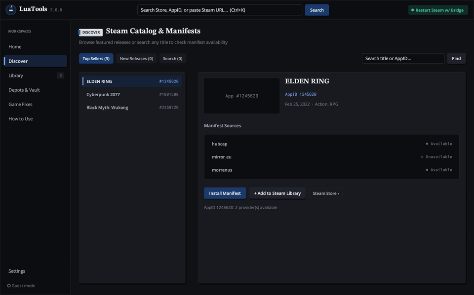
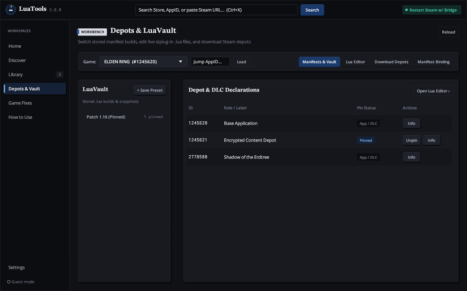
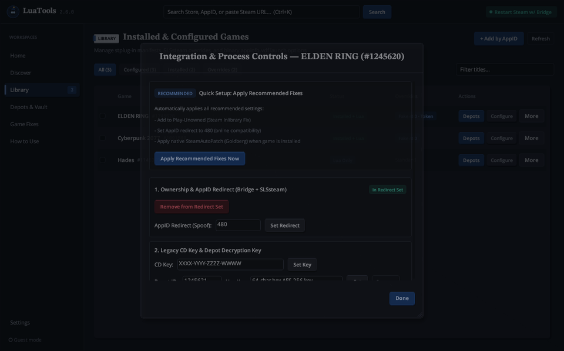
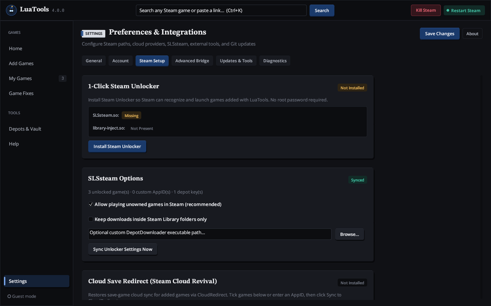

<div align="center">
  
  <h1>LuaTools Linux</h1>
  <p><strong>Add Steam games, set up SLSsteam, manage DLC &amp; depots, and apply game fixes on Linux.</strong></p>
  <p>
    <a href="https://github.com/subsurfmod/LuaToolsLinux/releases/latest">
      
    </a>
  </p>
</div>

---

## What It Does

- **Find & add Steam games** — Search any game in **Add Games** to install its `.lua` manifest, or drag and drop `.lua`, `.manifest`, or `.zip` files onto **Home**.
- **One-click Steam setup** — Install and configure **SLSsteam** in one click (no root password required) so Steam recognizes and launches your added games.
- **Manage DLC, depots & launch options** — Toggle DLCs, switch saved `.lua` builds, download game depots, and edit Steam launch options.
- **Apply game fixes** — Apply or revert game fixes, offline patches, and per-game compatibility settings from one place.

---

## How to Use (Quick Start)

1. **Setup Steam** — Click **Setup Steam** in the top-right bar (or go to **Settings › Steam Setup**) and click **Install Steam Unlocker (SLSsteam)**.
2. **Add a Game** — Drop a `.lua`, `.zip`, or `.manifest` file on **Home**, or search for a game in **Add Games** and click **Install Game**.
3. **Configure or Play** — Click **Open** on any added game on **Home** (or **Integrate** in **My Games**) to open its Integration & Quick Setup window, or click **Launch Steam** / **Restart Steam** in the top-right corner.

---

## Install & Uninstall

### One-Line Install

```bash
curl -fsSL https://raw.githubusercontent.com/subsurfmod/LuaToolsLinux/main/install.sh | bash -s -- --yes
```

### Install from Git

```bash
git clone https://github.com/subsurfmod/LuaToolsLinux.git
cd LuaToolsLinux
./install.sh --yes
```

### Native Packages (`.deb` / `.rpm`)

Build packages locally with `./packaging/build-packages.sh`, or install a release package:

```bash
# Ubuntu / Debian / Pop!_OS
sudo apt install ./dist/luatools-linux_3.2.3_amd64.deb

# Fedora / RHEL / openSUSE
sudo dnf install ./dist/luatools-linux-3.2.3-1.*.rpm
```

### Update & Uninstall

- **Update**: Click **Update** in the top-right corner when a new version is available, or run `luatools --update`.
- **Uninstall**:
  ```bash
  curl -fsSL https://raw.githubusercontent.com/subsurfmod/LuaToolsLinux/main/uninstall.sh | bash
  ```

---

## Screens at a Glance

- **Home** — Drag and drop game files (`.lua`, `.manifest`, `.zip`), check your Steam & unlocker status tiles, and click **Open** (or **Depots & DLC**) on any recently added game.
- **Add Games** — Browse Top Sellers and New Releases, or search by game name, AppID, or Steam link to click **Install Game** (plus **Open Setup / Integration**, **Files & DLC**, **Game Fixes**, and **Launch Options** once added).
- **My Games** — View and filter your games with 1-click **Integrate**, **Files & DLC**, and **Edit .lua** buttons, plus a **More** menu for **Game Fixes…**, **Launch Options…**, offline/DRM tools, and opening the game folder.
- **Depots & Vault** — Toggle individual DLCs, save or switch `.lua` build presets, edit `.lua` files directly, pin manifest versions, and download depots.
- **Game Fixes** — Browse available fixes for your games, apply them with automatic backups, or revert back to original files at any time.
- **Help** — Built-in visual guide, templates, and troubleshooting tips.
- **Settings** — Configure Steam paths, sign in for cloud manifest downloads, set up **SLSsteam**, enable Cloud Save Redirect or the Steam Store Page Plugin, manage optional tools, and check for updates.

---

## Screenshots

### 1. Home
Drop `.lua`, `.manifest`, or `.zip` files, check setup status at a glance, and click **Open** on any added game to open its Integration & Quick Setup window (or **Depots & DLC** to manage files).


### 2. Add Games
Search the Steam catalog, pick an available manifest source, and click **Install Game**.


### 3. Depots & Vault
Switch saved `.lua` presets, toggle DLCs on or off, edit `.lua` files, and download depots.


### 4. Per-Game Integration & Quick Setup Window
Click **Open** on an added game on **Home** (or **Integrate** in **My Games**) to open **Integration & Process Controls** — apply recommended fixes, AppID redirects, and launch settings in one click.


### 5. Advanced Steam Bridge Settings
Optional per-launch Steam client integration and live `.lua` folder reload controls in **Settings › Advanced Bridge**.


### 6. One-Click SLSsteam Setup
Install **SLSsteam**, sync unowned-game settings, and configure store plugins in **Settings › Steam Setup**.


---

## Keyboard Shortcuts

| Shortcut | Action |
| :--- | :--- |
| `Ctrl+K` / `Ctrl+L` | Focus top search bar (game name, AppID, Steam URL, or file path) |
| `Ctrl+1` … `Ctrl+5` | Switch between `Home`, `Add Games`, `My Games`, `Depots & Vault`, and `Game Fixes` |
| `Ctrl+6` / `F1` | Open `Help` (`Esc` closes open windows and previews) |
| `Ctrl+7` / `Ctrl+,` | Open `Settings` |
| `Ctrl+Q` | Quit LuaTools |

---

## License

Licensed under the **MIT License** — see [LICENSE](LICENSE) for details.
