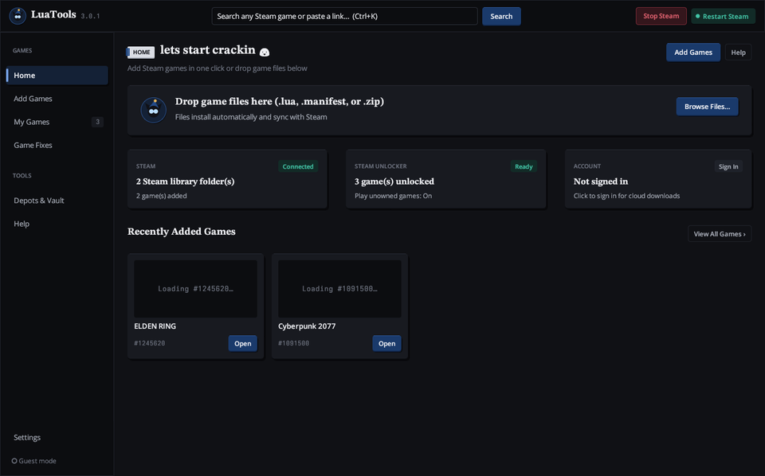
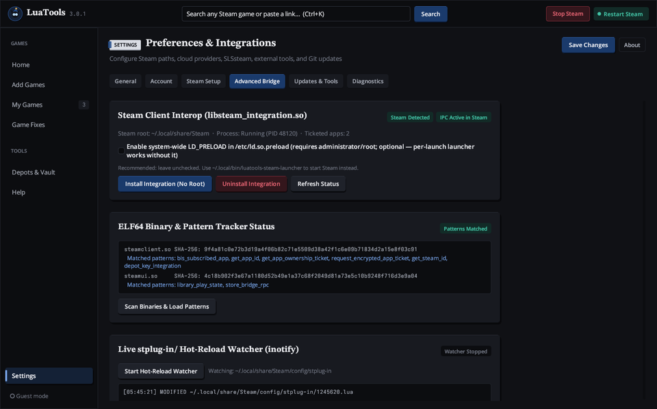

<div align="center">
  <h1>LuaTools Linux — Native Rust Edition (v3.0.1)</h1>
</div>

<div align="center">
  
  <p><strong>Lightweight Native Rust Workstation for Steam Game Manifests, Unlockers, Depots, and Fixes</strong></p>
</div>

<p align="center">
  <a href="https://github.com/subsurfmod/LuaToolsLinux/releases/latest">
    
  </a>
</p>

---

## Overview

**LuaTools Linux v3.0.1** is a fast, low-memory, zero-Python native Rust desktop application (`eframe` / `egui`) for managing Steam `.lua` game manifests, `SLSsteam` & rootless `libsteam_integration.so` game unlockers, `LuaVault` build snapshots, `DepotDownloader` downloads, binary `appinfo.vdf` launch options, and SHA-256 verified game fixes on Linux.

### Highlights in v3.0.1 (Major Upgrade from `v2.6.1`)
- **Ultra-Low Memory Footprint (~87 MB VmRSS / ~45 MB PSS / ~25 MB Private Heap)**: Cut RAM usage by **59% VmRSS** and **74% private heap** via 64 KiB streaming `applist.json` resolution, single-vendor Mesa EGL selection on hybrid laptops, lazy GTK3 tray initialization, downscaled 24-slot LRU cover textures, lazy catalog loading, and zero per-frame disk/hash polling.
- **Simple, Friendly Interface for Everyday Users**: Streamlined sidebar (`Home`, `Add Games`, `My Games`, `Game Fixes`, plus `Depots & Vault` and `Help`), clickable Home setup status tiles, 1-click **Install Steam Unlocker (SLSsteam)** at the top of **Settings › Steam Setup**, and expert controls tucked neatly into **Advanced** submenus and collapsible drawers.
- **100% Wired & Forensic-Audited Linux Parity (`v2.6.1 -> v3.0.1`)**: Single-instance `flock` + Unix socket IPC, `luatools://` & `bst://` URI handlers, silent background installs, `age` x25519/AES-GCM encrypted credentials, binary `.manifest` protobuf codec, `LaunchModStore` PICS drift rebase, `OverwriteDiffModal`, 100-item Download History ring, Denuvo PE `ProtectionScan`, `AppliedFixIndexService`, full 13-route LTSP Store Plugin server, and **413 passing workspace tests**.

---

## Quick Start (3 Simple Steps)

1. **Install the Steam Unlocker (One-Time Setup)**:
   Click **`Setup Steam`** in the top-right bar (or click the **STEAM UNLOCKER** tile on **Home** -> **Settings › Steam Setup**) and click **`Install Steam Unlocker (SLSsteam)`**. No root password is required.
2. **Add Games**:
   - Drag and drop any `.lua`, `.manifest`, or `.zip` file onto **Home** (or click **`Browse Files…`**), **or**
   - Open **Add Games**, search any Steam title (or paste a Steam Store / SteamDB URL into the top search bar), and click **`Install Game`**.
3. **Launch Steam**:
   Click **`Launch Steam`** (or **`Restart Steam`**) in the top-right corner so Steam picks up your newly added games.

---

## Complete Feature & Function Guide

### Primary Workspaces

| Screen | What It Does & How to Use Each Function |
| :--- | :--- |
| **Home** (`Ctrl+1`) | **Drop Zone & Status Hub**: Drag-and-drop `.lua`, `.manifest`, or `.zip` files (or click **`Browse Files…`**) to install into `stplug-in/`, snapshot in `LuaVault`, and sync `SLSsteam`. Click any of the 3 status tiles (**STEAM**, **STEAM UNLOCKER**, **ACCOUNT**) to jump straight to its setup screen. Click any card in **Recently Added Games** to open its files and DLC. |
| **Add Games** (`Ctrl+2`) | **Steam Store Search & Cloud Manifests**: Browse **Top Sellers**, **New Releases**, or search any title/AppID. Select a title to view available manifest providers (Morrenus, Hubcap, mirrors), click **`Install Game`** (with **FastFetch** auto-selecting the fastest source and **Overwrite Diff Modal** protecting existing customized `.lua` files), **`+ Add to Steam Library`** (writes `appmanifest_<appid>.acf` + `libraryfolders.vdf`), **`Generate DLC`** when missing DLCs are detected, or expand **Download Queue & History** (100-item persistent ring). |
| **My Games** (`Ctrl+3`) | **Your Steam + LuaTools Library**: Filter by **All**, **Added**, **Installed**, or **Custom**, bulk-select rows to remove `.lua` entries, or click **`+ Add by AppID`** to scaffold a new `.lua` from templates. Per-game buttons:<br>• **`Files & DLC`** — opens **Depots & Vault** for that game.<br>• **`Options`** — opens the Game Detail modal to edit live `.lua` (with syntax highlighting & validation), `FakeAppId` (`480`), and `AppToken`.<br>• **`More`** — quick access to **`Game Fixes…`**, **`Launch Options…`** (non-blocking binary `appinfo.vdf` editor with automatic Steam coordination, backup/restore, and PICS drift rebase), **`Open Game Folder`**, **`Remove from LuaTools`**, and the **`Advanced Tools`** submenu (**Quick Fix & Overrides** 1-click setup, **Launch with Integration**, **Add/Remove Steam Library ACF**, **Enable/Disable Play Unowned**, **Offline Patch (Goldberg)**, **Remove SteamStub DRM (Steamless)**, and **Clean Old Unlockers**). |
| **Game Fixes** (`Ctrl+5`) | **Verified Game & DRM Fixes**: Filter by tag or **Configured only**, pick a title, and click **`Install Manifest`**, **`Apply Fix`** (backs up original files with SHA-256 into `<GameDir>/.luatools-fix/` and indexes in `applied-fixes.json`), **`Revert`** (asynchronously restores original binaries byte-for-byte with progress bar), or **`Verify Integrity (SHA-256)`**. |

### Advanced Tools & Reference Workspaces

| Screen | What It Does & How to Use Each Function |
| :--- | :--- |
| **Depots & Vault** (`Ctrl+4`) | **4-Tab Build & Depot Workbench**:<br>• **`Manifests & Vault`**: Switch between SHA-256 `LuaVault` build presets, save/rename/delete snapshots, toggle **Pin / Unpin** (`setManifestid`), and toggle individual **DLC checkboxes**.<br>• **`Lua Editor`**: Full syntax-highlighted live `.lua` editor with real-time error/key validation and in-place `LuaVault` sync.<br>• **`Download Depots`**: Select content depots, sign in via Steam QR (`-remember-password`), and download via `DepotDownloader` / `DepotDownloaderMod` using temporary `0600` `-depotkeys` files with `2x` disk-space verification.<br>• **`Manifest Binding`**: Pin exact `(Depot ID, 19-digit Manifest GID)` locks synced to both `SLSsteam` `ManifestIds` and `libsteam_integration.so` over Unix IPC. |
| **Help** (`Ctrl+6` / `F1`) | **Illustrated 6-Tab Manual**: Step-by-step walkthroughs (`Quick Start`, `Adding Games & .lua`, `Depots, Vault & Binding`, `One-Click Fixes & Library`, `Steam Interop, Wired & Cloud`, `FAQ & Shortcuts`) with click-to-enlarge screenshots and copyable `.lua` templates. |
| **Settings** (`Ctrl+7` / `Ctrl+,`) | **6 Focused Sub-Tabs (Checkboxes Auto-Save Immediately)**:<br>• **`General`**: Custom Steam path override, Auto-update apps, FastFetch, Donate Keys (`config.vdf` key submission), **Rescan / Restart / Kill Steam**, **OS Login Autostart**, and opt-in **System Tray** controls.<br>• **`Account`**: Discord OAuth browser login, 6-char Discord `/login` bot code, **Hubcap API key** (`smm_...`) verifier (encrypted at rest via `age` x25519/AES-GCM), and **DepotDownloader QR Sign-In**.<br>• **`Steam Setup`**: **1-Click Steam Unlocker (SLSsteam)** & **ACCELA** native Rust installer, **SLSsteam Options** (`PlayNotOwnedGames` + `play_unowned_games.lua` sync), plus a collapsible **Advanced** drawer for **Cloud Redirect** (Steam Cloud save revival) and **Steam Store Bridge** (Millennium RPC probe, CEF debugging toggle, `luatools://` / `bst://` URI registration, and **Install Store Page Plugin (LTSP)**).<br>• **`Advanced Bridge`**: Rootless `libsteam_integration.so` install/uninstall (optional `/etc/ld.so.preload` toggle), ELF64 `steamclient.so`/`steamui.so` SHA-256 & pattern scanner, and live `inotify` **`stplug-in/` Hot-Reload Watcher** log.<br>• **`Updates & Tools`**: Automatic startup Git update checker, 1-click **`Pull & Update Now`**, and external toolchain manager (**DepotDownloaderMod**, **Goldberg Emulator** Linux `.so` + Proton Windows `.dll`, **SteamAutoPatch**, **StubRemover / Steamless**).<br>• **`Diagnostics`**: Privacy-first PII-scrubbed crash/error telemetry toggle, 1-click GitHub bug report, Markdown diagnostic exporter, optional webhook tester, and local event viewer. |

### Top Bar, URI Protocols, Local Store RPC & CLI Options

- **Top Command Bar**:
  - **Quick Search (`Ctrl+K` / `Ctrl+L`)**: Accepts game names, numeric AppIDs, Steam Store URLs, SteamDB URLs, `steam://`, `luatools://`, `bst://`, or local `.lua`/`.zip`/`.manifest` paths.
  - **Steam Action Pill**: Automatically displays **`Launch Steam`** (blue), **`Restart Steam`** (green when running), **`Setup Steam`** (amber if unlocker not installed), or **`Rescan Steam`** — plus **`Stop Steam`** when Steam is running and **`Update`** when a newer Git release is available.
- **Desktop URI Handlers (`luatools://` & `bst://`)**:
  - `luatools://game/<appid>` — open game details in **Add Games**.
  - `luatools://install/<appid>` or `luatools://install/silent/<appid>` — download & install manifest (optionally headless/silent without stealing focus).
  - `luatools://manage/<appid>` / `luatools://fix/<appid>` — jump straight to **Depots & Vault** or **Game Fixes**.
  - `bst://<appid>/<token>` / `bst://redeem/<code>` — persist Steam app tokens directly into `SLSsteam` `config.yaml`.
- **Local Store Plugin HTTP Server (`127.0.0.1:6767`)**:
  - Powers the Steam Store Page Plugin (`luatools.js`) with PNA CORS headers and full routes (`/ping`, `/has`, `/check/:id`, `/add`, `/add-status`, `/add-source`, `/check-sources`, `/download`, `/download-status`, `/cancel`, `/remove`, `/open/fix`, `/open/settings`, `/open-url` with strict URL & RFC 2606 validation, `/restart-steam`, `/check-updates`, `/loaded-apps`, `/api-list`, `/icon`, `/rpc`).
- **Command-Line Interface (`luatools [OPTIONS]`)**:
  - `--check` — verify binary, version, and Steam library detection without launching the GUI.
  - `--update` — pull latest source from Git, rebuild release binaries, and update atomically.
  - `--minimized` / `--tray-locked` — start minimized to the system tray and keep running in background on window close.
  - `--autostart-enable` / `--autostart-disable` — add or remove `~/.config/autostart/luatools.desktop`.
  - `-v, --version` / `-h, --help` — print version or usage help.

---

## Installation

### One-Line Universal Installer (Includes All Dependencies)

Run the universal `curl` one-liner — it verifies/installs required Linux graphics, XDG, and archive runtime packages (`dnf` / `apt` / `pacman` / `zypper`), clones the repository into `~/.local/share/luatools/repo`, bootstraps `rustup` if needed to compile stripped native binaries (`luatools` + `libsteam_integration.so` + `libsteam_auto_patch_linux.so`), installs the desktop launcher & icon, and registers `luatools://` and `bst://` URI schemes:

```bash
curl -fsSL https://raw.githubusercontent.com/subsurfmod/LuaToolsLinux/main/install.sh | bash -s -- --yes
```

### Install from Local Clone

```bash
git clone https://github.com/subsurfmod/LuaToolsLinux.git
cd LuaToolsLinux
./install.sh --yes
```

### Installer Options & Uninstallation

- **System-wide install (`/usr/local/bin/luatools`)**:
  ```bash
  curl -fsSL https://raw.githubusercontent.com/subsurfmod/LuaToolsLinux/main/install.sh | bash -s -- --yes --system
  ```
- **Include optional Wine + .NET runtimes** (for Windows tools like Steamless / SteamAutoCrack):
  ```bash
  curl -fsSL https://raw.githubusercontent.com/subsurfmod/LuaToolsLinux/main/install.sh | bash -s -- --yes --with-wine
  ```
- **Uninstall cleanly** (removes binary, shared libraries, autostart entry, desktop file & URI MIME handlers; pass `--purge` to also remove cached data):
  ```bash
  curl -fsSL https://raw.githubusercontent.com/subsurfmod/LuaToolsLinux/main/uninstall.sh | bash
  ```

---

## Visual Walkthrough & Screenshots

### 1. Home Workspace & Top-Right Steam Pill


### 2. Add Games Catalog & Cloud Manifest Providers


### 3. Depots, LuaVault Presets & Manifest Binding


### 4. My Games & One-Click Recommended Fixes Modal


### 5. Advanced Bridge — Rootless Steam Interop & ELF64 Pattern Scanner


### 6. Steam Setup — 1-Click SLSsteam Unlocker & Collapsible Advanced Bridges


---

## Building Native Packages

Build native `.rpm`, `.deb`, and portable `.tar.gz` packages from source:

```bash
./packaging/build-packages.sh
```

Outputs self-contained distributables into `dist/`:

| Target Distribution | Install Command |
| :--- | :--- |
| **Fedora / RHEL / openSUSE** | `sudo dnf install ./dist/luatools-linux-3.0.1-1.*.rpm` |
| **Ubuntu / Debian / Pop!_OS** | `sudo apt install ./dist/luatools-linux_3.0.1_amd64.deb` |
| **Any Linux Distro (No root required)** | Extract `dist/luatools-linux-3.0.1-x86_64.tar.gz` and run `./install.sh --yes --skip-deps` |

---

## Effortless Git Self-Updates

- On startup, `luatools` runs **one lightweight non-blocking background check** against your Git remote (`origin` or a custom Git URL configured in **Settings › Updates & Tools**).
- When new commits or a newer version exist upstream, an **`Update`** button appears in the **top-right corner** of the window.
- Clicking **`Update`** pulls the latest changes (`git pull`), compiles the workspace release binaries, atomically replaces the installed binary without `ETXTBSY` locks, and turns into **`Restart`** for a 1-click relaunch (also available via CLI as `luatools --update`).

---

## Keyboard Shortcuts

| Shortcut | Action |
| :--- | :--- |
| **`Ctrl+K` / `Ctrl+L`** | Focus Global Search Bar (Game Name, AppID, Steam/SteamDB URL, `luatools://`, `bst://`, or Local File) |
| **`Ctrl+1` … `Ctrl+5`** | Switch between `Home`, `Add Games`, `My Games`, `Depots & Vault`, and `Game Fixes` |
| **`Ctrl+6` / `F1`** | Open the illustrated `Help` manual (`Esc` closes enlarged screenshot previews & modals) |
| **`Ctrl+7` / `Ctrl+,`** | Open `Settings` |
| **`Ctrl+Q`** | Quit application cleanly |

---

## License

This project is licensed under the **MIT License** — see [LICENSE](LICENSE) for full details.

---

<div align="center">
  <h2>LUATOOLS LINUX v3.0.1</h2>
  <p><strong>Native Rust Edition · Lightweight Steam Manifest & Unlocker Workstation</strong></p>
</div>
